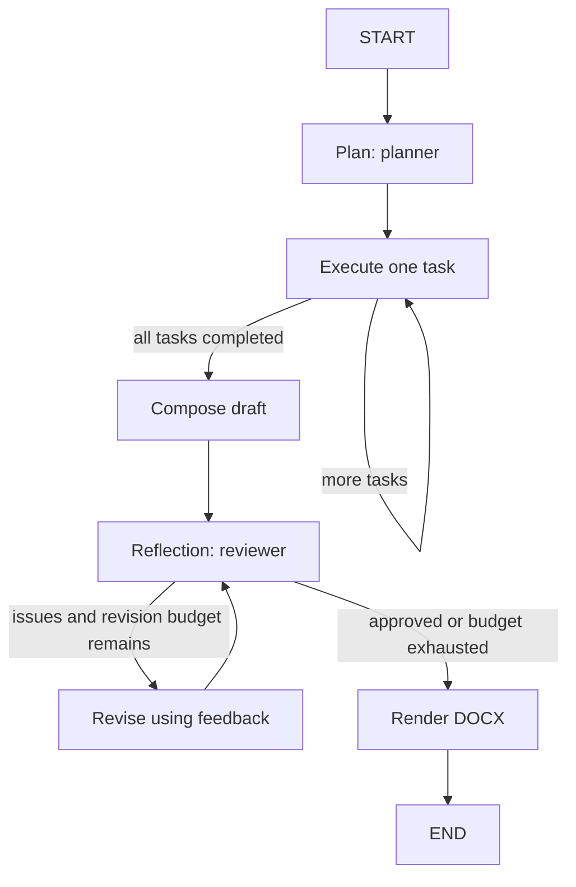

# Autonomous DOCX Agent

A Python 3.11+ FastAPI application that turns a business request into a structured
plan, executes its tasks, composes and self-checks a draft, and renders a real Word
document using LangGraph and python-docx. The roles run sequentially, not as
parallel workers. There is no web research or silent fake-model fallback.

## Run Locally

From the project root, using your existing Anaconda `base` environment:

```powershell
conda activate base
python -m pip install -r requirements.txt
python -m uvicorn app.main:app --reload
```

If you need a separate environment instead, the optional setup commands are:

```powershell
python -m venv .venv
.\.venv\Scripts\python.exe -m pip install -r requirements.txt
.\.venv\Scripts\python.exe -m uvicorn app.main:app --host 127.0.0.1 --port 8000
```

Configure `.env` before submitting a request. Interactive API documentation is at
`http://127.0.0.1:8000/docs`; `GET /health` reports configuration, not provider
connectivity. Relative `OUTPUT_DIR` values resolve from the project root.

## Model Configuration

Configure your own secret keys in `.env`; tracing is disabled by default. Choose
one provider and restart the server after configuration changes.

- **Poolside Laguna API:** the project selects `LLM_PROVIDER=poolside` with
  `POOLSIDE_MODEL=poolside/laguna-s-2.1` and
  `POOLSIDE_BASE_URL=https://inference.poolside.ai/v1`. Fill `POOLSIDE_API_KEY`
  locally in `.env` using your Poolside Platform API key. Set `POOLSIDE_MODEL`
  to the exact hosted model ID available to your account if it differs from the
  documented default. Model discovery and authentication are documented at
  `https://docs.poolside.ai/api/overview`.
- **Groq free tier:** set `LLM_PROVIDER=groq`, obtain your own key from
  `https://console.groq.com/keys`, and set `GROQ_API_KEY`. The default model is
  `GROQ_MODEL=openai/gpt-oss-20b`. Free-tier quotas, eligibility, and model
  availability may change; multiple task and review calls consume quota.
- **Local Ollama:** set `LLM_PROVIDER=ollama`, keep
  `OLLAMA_BASE_URL=http://localhost:11434` and `OLLAMA_MODEL=llama3.1:8b`, and run
  `ollama pull llama3.1:8b`. Start the local service with `ollama serve` if it is
  not already running. No Groq key is needed. Model downloads and inference need
  adequate disk, memory, and compute; structured-output quality varies by model.

Poolside uses OpenAI-compatible Chat Completions through `langchain-openai`.
Each request includes JSON-schema format instructions in the system prompt, and
`PydanticOutputParser` parses and validates the returned content locally. Invalid
JSON, schema violations, and Word/XML-incompatible content trigger the existing
bounded correction retries. This does not assume native `response_format` support
or guarantee schema-constrained generation on Poolside's hosted service.

Poolside thinking is disabled with `chat_template_kwargs.enable_thinking=false`,
following the extraction/structured-output guidance at
`https://docs.poolside.ai/tools/n8n`. It uses `LLM_TEMPERATURE`; the Groq reasoning
setting is not sent to Poolside. Requests use Chat Completions, not the Responses API.

Groq and Ollama retain `method="json_schema"` for structured output. Groq's gpt-oss
models support schema-constrained generation, avoiding the malformed function-call
arguments seen with function calling. Application-level validators and human
review remain necessary; structured output does not guarantee factual accuracy.
The selected provider is reported by `/health` and in LangSmith run metadata.
Provider selection is explicit: the application does not silently fall back to
another cloud service. Existing Groq and LangSmith keys are preserved when switching.

To switch providers, change `LLM_PROVIDER` to `poolside`, `groq`, or `ollama` and
restart the server. To rotate a Poolside key, replace only `POOLSIDE_API_KEY` locally.
Never paste credentials into requests, source code, recordings, or chat.

`LLM_TIMEOUT_SECONDS=90` limits each model attempt. The project `.env` sets
`LLM_MAX_RETRIES=6`, allowing six retries (seven attempts), and
`AGENT_TIMEOUT_SECONDS=600` bounds the entire graph.
A missing key for the selected cloud provider returns 503 instead of a fabricated document. Rate-limit
exhaustion returns 429 with `Retry-After` when available; other provider failures return 502,
agent timeout returns 504, and rendering/internal failures return safe 500 errors.

## Rate Limits

`LLM_MIN_INTERVAL_SECONDS=15` spaces call starts by at least fifteen seconds across
requests sharing the same LLM client. It is not an extra three-second delay after
each completed call, and it is not a token-per-minute budget. Retry backoff starts
at 2 seconds, then 4, 8, 16, 32, and 64 seconds, honoring a longer provider `Retry-After` value.
Waits above 90 seconds return 429 immediately rather than keeping the request open.
Poolside and Groq account/model quotas still apply even when calls are paced.
HTTP 429 errors and numeric `Retry-After` headers are recognized even when the
SDK wraps the original exception.

`TOKEN_BUDGET` in `app/llm/providers.py` sets output caps per schema, using Poolside
and Groq `max_tokens`, or Ollama `num_predict`. Clients are cached by token budget.
Poolside's documented `max_tokens` is sent through `ChatOpenAI.extra_body` so the
SDK does not rewrite it to OpenAI's `max_completion_tokens` parameter.

| Schema | Token Cap |
|---|---:|
| `DocumentPlan` | 2000 |
| `TaskResult` | 2000 |
| `ReviewResult` | 2000 |
| `DocumentContent` (compose/revise) | 5000 |

`LLM_MAX_TOKENS` is the fallback for other schemas; it does not override the four
budgets above. Increase the relevant `TOKEN_BUDGET` entry if output is truncated,
not the global fallback. Larger allowances can increase quota usage.

`GROQ_REASONING_EFFORT=low` reduces reasoning overhead for compatible Groq models.
Set `GROQ_REASONING_EFFORT=` to omit that parameter if the SDK or model rejects it.
Warnings include `schema`, `attempt`, HTTP `status`, `error_type`, and a
`detail=` excerpt of up to 300 characters, with configured API keys redacted.
Use those details to distinguish malformed generation, invalid parameters,
connection problems, and quota failures. Set `MAX_REVISIONS=0` for a diagnostic
request to avoid additional revision calls; the reviewer still runs.

## Reflection / Self-Check

The headline engineering improvement is **Reflection / Self-Check**. A separate
review pass checks request coverage, consistency, assumptions, mock-data labeling,
and document structure. Actionable feedback is passed to the writer for revision,
then the revised draft is reviewed again. `MAX_REVISIONS` defaults to 1 and supports
0 through 3. Exhausting that budget does not manufacture approval: the response
is `completed_with_warnings`, the rejected review remains visible, and the DOCX
contains review notes requiring human attention. LLM approval is not factual,
legal, or professional verification.

I chose reflection because a first draft can omit requirements or contain
inconsistent estimates, especially when a brief is ambiguous or missing data.
The bounded review-and-revise loop improves completeness and coherence without
requiring a person to supervise every intermediate step.

The reviewer returns a per-requirement/conflict-resolution checklist. The review
node rejects approval when the score is below 7 or any checklist item is unmet,
and adds corrective feedback instead of retrying an otherwise valid review.



The planner is instructed to produce 2-4 distinct tasks (the schema permits 1-4).
Plans record interpretation, assumptions, and conflict resolutions. A task is marked completed only after its
structured result succeeds. Composition supports headings, paragraphs, bullets,
and rectangular tables. Rendering adds a title, contents list, UTC timestamp,
assumptions/limitations appendix, conflict resolutions, and any unresolved review notes. Schema
validation rejects malformed tables and Word/XML-incompatible text.

## Example Requests

`POST /agent` accepts `{"request": "...", "include_base64": false}` with 15-6000
request characters after trimming surrounding whitespace. `include_base64` is
optional and defaults to false. Other extra fields are rejected with 422.

To receive the Word document in the JSON response as well as a download URL:

```json
{
  "request": "Create a concise onboarding SOP with roles, a checklist, and labeled assumptions.",
  "include_base64": true
}
```

Standard proposal, using Windows curl (`curl` on macOS/Linux):

```powershell
curl.exe -sS -X POST "http://127.0.0.1:8000/agent" -H "Content-Type: application/json" --data-binary "@examples/standard_request.json"
```

Complex expansion brief, using PowerShell, followed by its DOCX download:

```powershell
$result = Invoke-RestMethod -Method Post -Uri "http://127.0.0.1:8000/agent" -ContentType "application/json" -Body (Get-Content -Raw "examples/complex_request.json")
Invoke-WebRequest -Uri $result.document.download_url -OutFile $result.document.filename
```

The standard input is a scoped onboarding proposal. The complex input requires
the agent to choose a launch strategy, create a multi-step plan, and make explicit
assumptions about missing location, staffing, cost, and demand information while
respecting a fixed budget. Both require mock-data labels and human validation. Requests
can take several model calls; a more complex request may exceed free-tier quotas
or the overall timeout.

## Response And Download

Illustrative response shape; text, IDs, timings, tasks, and review outcomes vary:

```json
{
  "run_id": "12345678-1234-4234-8234-123456789abc",
  "status": "completed",
  "message": "Created an illustrative project brief.",
  "summary": "An illustrative recommendation requiring human validation.",
  "plan": {
    "title": "Illustrative Project Brief",
    "document_type": "Business brief",
    "audience": "Project sponsors",
    "interpretation": "Prepare a concise illustrative project brief.",
    "assumptions": ["All estimates are mock data."],
    "conflicts": [],
    "tasks": [{"title": "Define scope", "instructions": "Develop the proposed scope."}]
  },
  "tasks": [{
    "number": 1,
    "title": "Define scope",
    "instructions": "Develop the proposed scope.",
    "status": "completed",
    "result": {"summary": "Scope drafted.", "findings": ["Confirm the illustrative scope."]}
  }],
  "review": {
    "approved": true,
    "score": 8,
    "feedback": [],
    "checklist": [{"requirement": "Define the scope", "met": true, "note": "Included."}]
  },
  "revisions": 0,
  "warnings": [],
  "document": {
    "filename": "12345678123442348234123456789abc.docx",
    "download_url": "http://127.0.0.1:8000/documents/12345678123442348234123456789abc",
    "media_type": "application/vnd.openxmlformats-officedocument.wordprocessingml.document",
    "base64": null
  },
  "trace": {"enabled": false, "project": null, "run_id": null, "url": null},
  "elapsed_seconds": 12.4
}
```

By default the response contains a document reference, not a filesystem path.
With `include_base64=true`, `document.base64` also contains the Base64-encoded DOCX;
otherwise that field is null. Decode it as binary DOCX data, not text.
Fetch `document.download_url` with `GET /documents/{document_id}` to receive a
DOCX attachment. IDs must be UUIDs (hex or hyphenated); missing files return 404
and invalid UUIDs return 422. Only server-generated UUID filenames are selected.

## Optional LangSmith Tracing

To opt in, set `LANGSMITH_TRACING=true`, supply `LANGSMITH_API_KEY`, and select
`LANGSMITH_PROJECT` (default `autonomous-docx-agent`) in `.env`. Leave
`LANGSMITH_ENDPOINT=https://api.smith.langchain.com` unless using another approved
endpoint. Restart the server. Traces capture graph stages and provider calls;
local `app.timing` logs report per-node durations while decorators preserve node
signatures and `RunnableConfig` forwarding for model-call tracing.
`trace.enabled`, project, and run ID identify the run. `trace.url` may be null;
find the run in the named LangSmith project. If tracing cannot initialize, the
agent continues with a warning instead of claiming tracing succeeded.

**Privacy:** traces can send the full request, generated content, task results,
and review feedback to LangSmith. The selected cloud provider (Poolside or Groq)
also receives model prompts and content.
Do not submit confidential or regulated data without authorization and retention
controls. For local inference, use Ollama with tracing disabled. Never commit
API keys; `.gitignore` excludes `.env`, generated documents, logs, and caches.

## Tests

```powershell
python -m pytest -q test
```

Tests inject deterministic structured models, use context-managed FastAPI
`TestClient`, and run graph coroutines with `asyncio.run`; pytest-asyncio is not
needed. Coverage includes distinct task execution, revision and exhausted-budget
paths, both examples, real DOCX ZIP/title/table/assumption checks, request/table/XML
validation, download safety, missing credentials, safe failures, and cancellation
without late artifact publication. Tests suppress external tracing and use
temporary output directories. The default suite does not exercise live Poolside,
Groq, Ollama, or LangSmith; live checks must be run separately with configured credentials.

Provider tests cover real SDK construction, Groq/Ollama schema conversion, and
Poolside JSON parsing without network calls. Mock HTTP transport verifies Poolside's
actual endpoint, authentication, model ID, token cap, thinking control, and schema
instructions. Tests also cover per-schema budgets and client caching, sanitized
error details, result validation, recovery, quota backoff, timeouts, and cancellation.

## Validation

After the Poolside migration, the full offline suite passed 116 tests in Anaconda
`base` with Python 3.14.6, and `python -m pip check` reported no broken requirements.
The tests verify the real SDK's requests using mock HTTP transport, local JSON
validation/recovery, authentication failures, rate-limit handling, and document
workflows. One non-blocking LangChain Pydantic V1/Python 3.14 warning remains.
These checks do not verify live Poolside model access or generated document quality.

The earlier Groq-focused validation in Conda `base` with Python 3.14.6 passed
73 tests. LangChain emits a non-blocking Pydantic V1/Python 3.14 compatibility
warning; this application uses Pydantic V2 models.

The standard example was also tested against Groq `openai/gpt-oss-20b` with a
15-second call interval, six retries, and revisions disabled for diagnostics.
After switching to JSON-schema output it returned HTTP 200 in approximately
93 seconds, generated a valid DOCX, and logged no HTTP 400 or 429 failures.
Seven model spans and the graph-stage spans were verified in LangSmith.

That draft scored 5/10 in self-review and correctly returned
`completed_with_warnings`: structural validity does not guarantee complete or
accurate content. The diagnostic used `max_revisions=0` without changing the
normal `.env` revision setting. Results and review scores vary between runs.

Those live timings and review scores belong to Groq, not Poolside. A live Poolside
document-generation run has not been performed. Access to the configured Laguna
model and document quality still depend on the account's model access and inference
quota; offline tests do not establish either.

## Demo Limitations

- No web browsing, retrieval, verified citations, or factual research. Invented
  figures and scenarios must be explicitly labeled illustrative mock data.
- Reflection can miss errors. Validate every generated document before acting on
  its financial, operational, legal, or medical content.
- Authentication, authorization, rate limiting, and artifact expiration are
  absent. This is a local demo, not a production or public deployment. Anyone
  with a document URL can download it while the file exists.
- DOCX content and generated UTC timestamps remain in `OUTPUT_DIR`; UUID run IDs
  appear in responses and local console logs. Documents are not automatically
  deleted. Console logs remain local unless the host redirects or exports them;
  opt-in tracing and cloud inference transmit the content described above.
- Calls are sequential and bounded by schema size, retries, revision limits, and
  deadlines. Free-tier quotas/models and local model compatibility may change.
